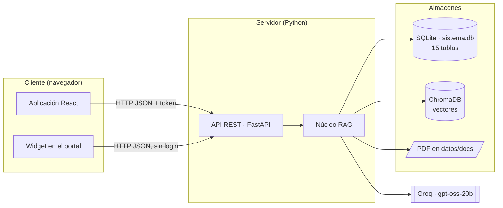
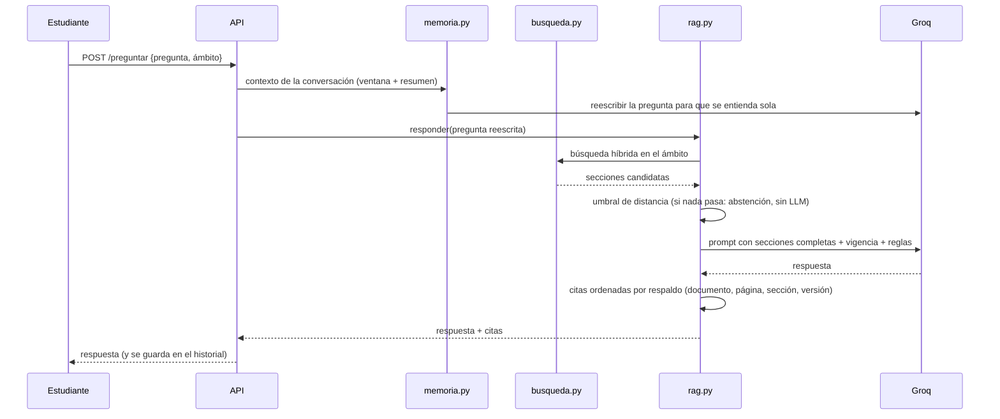

# Diseño de la arquitectura

## Vista de contenedores (nivel C4-2)

- **La API es el único backend.** Valida permisos endpoint por endpoint; el
  frontend solo oculta lo que no corresponde a cada rol.
- **El núcleo no conoce las interfaces.** Se puede sumar otra (bot, app móvil)
  sin tocar `nucleo/`.
- **SQLite es la fuente de verdad** (estructura, usuarios, catálogo de
  documentos y versiones, chat, consultas, bitácora, configuración). ChromaDB
  solo guarda los vectores; ambos se enlazan por id de documento y versión.

## Componentes del núcleo (nivel C4-3)

| Módulo | Responsabilidad |
|---|---|
| `rag.py` | Orquesta una respuesta: capa social, memoria, búsqueda, umbral, prompt, citas |
| `busqueda.py` | Búsqueda híbrida: vectores + BM25 fusionados con Reciprocal Rank Fusion |
| `memoria.py` | Memoria conversacional: ventana reciente + resumen + reescritura de la pregunta |
| `ingest.py` | Del PDF a los vectores: fragmentación por secciones, versiones, compensación ante fallos, reconciliación |
| `pdfreader.py` | Lectura de PDF por secciones (títulos por tamaño o numeración) y tablas fila por fila |
| `vectorstore.py` | Adaptador de ChromaDB |
| `embeddings.py` | Modelo `paraphrase-multilingual-MiniLM-L12-v2` (384 dimensiones, ~128 tokens por texto) |
| `llm.py` | Adaptador de Groq con medición de tokens y reintento ante límites |
| `bd.py` | Esquema relacional, migraciones y catálogo de documentos |
| `auth.py` | Contraseñas (PBKDF2), sesiones con expiración, usuarios y primer administrador |
| `historial.py` | Conversaciones y mensajes por usuario |
| `metricas.py` | Registro de consultas y agrupación de temas por significado |
| `parametros.py` | Configuración editable por el administrador |
| `config.py` | Carga de la API key desde `secretos.toml` o variables de entorno |

## Flujo de una pregunta

## Flujo de una subida de documento

1. El PDF se escribe en un archivo temporal y se **valida**: si no tiene texto
   suficiente (escaneado), se rechaza sin tocar nada.
2. Si ya existe un documento con ese nombre en el ámbito, el archivo vigente se
   archiva en `_versiones/` y su registro se actualiza.
3. El nuevo archivo pasa a su lugar y se registra la nueva versión en SQLite.
   Si algo falla en los pasos 2–3, se **deshacen** los anteriores.
4. Se reemplazan en ChromaDB los vectores del documento por los de la nueva
   versión. Si este paso fallara, `reconciliar()` lo corrige al arrancar.

## Fragmentación por secciones

El modelo de embeddings solo lee ~128 tokens (~680 caracteres) de cada texto.
Por eso se indexan **fragmentos cortos** (500 caracteres, solape 80) precedidos
por el título de su sección (y el de la sección principal si es una
subsección: "14 Evidencias › 14.2 Prácticas de inserción…"). Al responder, el
modelo de lenguaje recibe la **sección completa** (hasta 1.800 caracteres) de
donde sale cada fragmento recuperado, sin repetirla.

Los títulos se reconocen por la forma, no por el texto: letra más grande que el
cuerpo, o negrita con número de sección. Se omiten encabezados y pies repetidos
y las páginas del índice. Las tablas se leen fila por fila.
