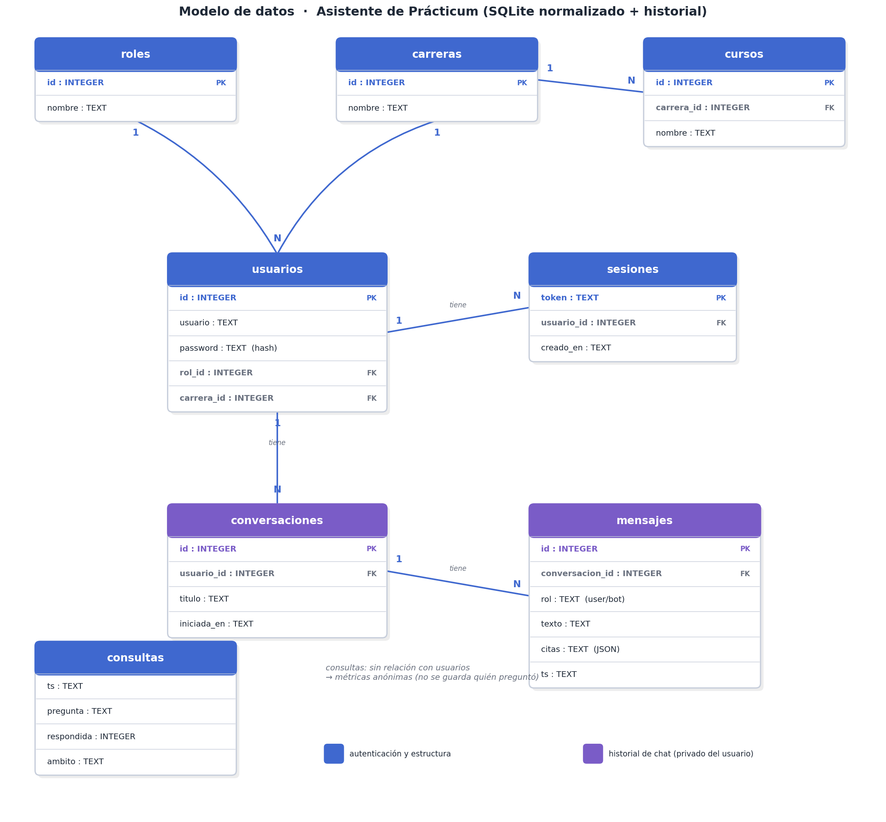

# Diseño de base de datos

El sistema usa **dos almacenes**:

| Almacén | Tecnología | Archivo | Qué guarda |
|---|---|---|---|
| Relacional | SQLite | `datos/sistema.db` | Toda la información del sistema (13 tablas) |
| Vectores | ChromaDB | `datos/chroma_db/` | Fragmentos de los PDF y sus embeddings |

Los PDF se guardan como archivos en `datos/docs/<carrera>/global/` y
`datos/docs/<carrera>/cursos/<curso>/`; las versiones anteriores, en la
subcarpeta `_versiones/`.



---

## 1. Base relacional (`sistema.db`)

Definida en `nucleo/bd.py`. Es la **fuente de verdad**: qué facultades,
carreras, cursos, usuarios y documentos existen lo decide esta base.

### Estructura académica

| Tabla | Columnas | Relación |
|---|---|---|
| `facultades` | id, nombre | 1 facultad → N carreras |
| `carreras` | id, facultad_id, nombre | 1 carrera → N cursos |
| `cursos` | id, carrera_id, nombre | único por (carrera, nombre) |

### Usuarios y acceso

| Tabla | Columnas | Nota |
|---|---|---|
| `roles` | id, nombre | estudiante, docente, coordinacion |
| `usuarios` | id, usuario, nombre, correo, password, rol_id, activo, creado_en | correo único con formato validado; password = hash PBKDF2 |
| `usuario_carrera` | usuario_id, carrera_id | **N:M**: un usuario puede tener muchas carreras |
| `sesiones` | token, usuario_id, creado_en, expira_en | la sesión caduca a las 8 horas |

Un usuario **desactivado** (`activo = 0`) no puede iniciar sesión y sus
sesiones abiertas se cierran; se conserva su historial.

### Documentos del RAG

| Tabla | Columnas | Nota |
|---|---|---|
| `documentos` | id, carrera_id, curso_id, nombre, activo, creado_en | `curso_id` NULL = documento global de la carrera |
| `documento_versiones` | id, documento_id, numero, ruta, fragmentos, subido_por, subido_en | una fila por cada vez que se sube el archivo |

- Subir un PDF con un nombre que ya existe en ese ámbito crea la **versión
  siguiente**. La anterior se mueve a `_versiones/` y queda registrada.
- Solo la versión vigente (la de número más alto) está indexada en ChromaDB.
- **Desactivar** un documento quita sus fragmentos de ChromaDB (el chat deja
  de usarlo) sin borrar nada. **Activarlo** lo vuelve a indexar.
- Para que dos documentos globales con el mismo nombre choquen se usa un
  índice único sobre `(carrera_id, IFNULL(curso_id, 0), nombre)`, porque en
  SQLite dos `NULL` nunca se consideran iguales.

### Chat

| Tabla | Columnas | Relación |
|---|---|---|
| `conversaciones` | id, usuario_id, titulo, iniciada_en | 1 usuario → N conversaciones |
| `mensajes` | id, conversacion_id, rol (user/bot), texto, citas (JSON), creado_en | 1 conversación → N mensajes |

La **memoria conversacional** usa estos mensajes: si la pregunta es un
seguimiento ("¿y cómo las distribuyo?"), se combina con la pregunta anterior
del usuario antes de buscar.

### Analítica y auditoría

| Tabla | Columnas | Nota |
|---|---|---|
| `consultas` | id, carrera_id, curso_id, usuario_id, modo, pregunta, respondida, creado_en | integrada al modelo; `usuario_id` NULL si se preguntó sin sesión (widget) |
| `logs` | id, usuario_id, accion, detalle, creado_en | bitácora: login, login fallido, altas, bajas, cambios de documentos |

`modo` registra desde dónde se respondió: `general` (reglamentos de la
carrera), `curso` (solo el material del curso) o `ambos`. El panel de
métricas solo muestra agregados; nunca muestra quién preguntó.

### Reglas de robustez

- **Fechas**: todas las columnas de fecha son `DATETIME`, se llenan solas
  con `datetime('now','localtime')` y tienen un `CHECK (x IS datetime(x))`
  que rechaza cualquier texto que no sea una fecha válida.
- **CHECK** en los valores cerrados: `activo IN (0,1)`, `rol IN ('user','bot')`,
  `modo IN ('general','curso','ambos')`, formato de correo, nombres no vacíos.
- **Claves foráneas** activadas en cada conexión (`PRAGMA foreign_keys = ON`)
  y con `ON DELETE` definido: `CASCADE` donde el hijo no tiene sentido sin el
  padre (mensajes, versiones), `SET NULL` donde el registro histórico debe
  sobrevivir (consultas, logs, `subido_por`), `RESTRICT` donde borrar dejaría
  datos inconsistentes (roles, facultades con carreras).
- **Transacciones**: cada operación corre dentro de `bd.transaccion()`; si algo
  falla se hace `ROLLBACK` y no queda nada a medias.
- **Índices** sobre las claves foráneas más consultadas.
- **Versión del esquema** en `PRAGMA user_version` (= 2). Si se detecta una base
  de la versión 1, se recrea automáticamente.

---

## 2. Base vectorial (ChromaDB)

No es relacional. Cada fragmento se guarda con su texto, su embedding
(384 números, MiniLM) y estos metadatos:

```json
{
  "fuente": "Reglamento_de_Practicum.pdf",
  "pagina": 3,
  "scope":  "computacion|global",
  "path":   "computacion/global/Reglamento_de_Practicum.pdf"
}
```

- `scope` = `<carrera>|global` o `<carrera>|curso:<curso>`; la búsqueda filtra
  por él según el modo elegido en el chat.
- id = `<scope>|<archivo>|<pagina>|<trozo>`.

El vínculo entre las dos bases es la **ruta** del archivo: `documento_versiones.ruta`
coincide con `path` en los metadatos de ChromaDB.

---

## 3. Si cambias de computadora

Si `sistema.db` es de la versión anterior, se recrea sola al arrancar. Luego
`python arrancar.py` detecta el catálogo vacío y reindexa los PDF de
`datos/docs/`. Para hacerlo a mano: `python -m nucleo.ingest`.
