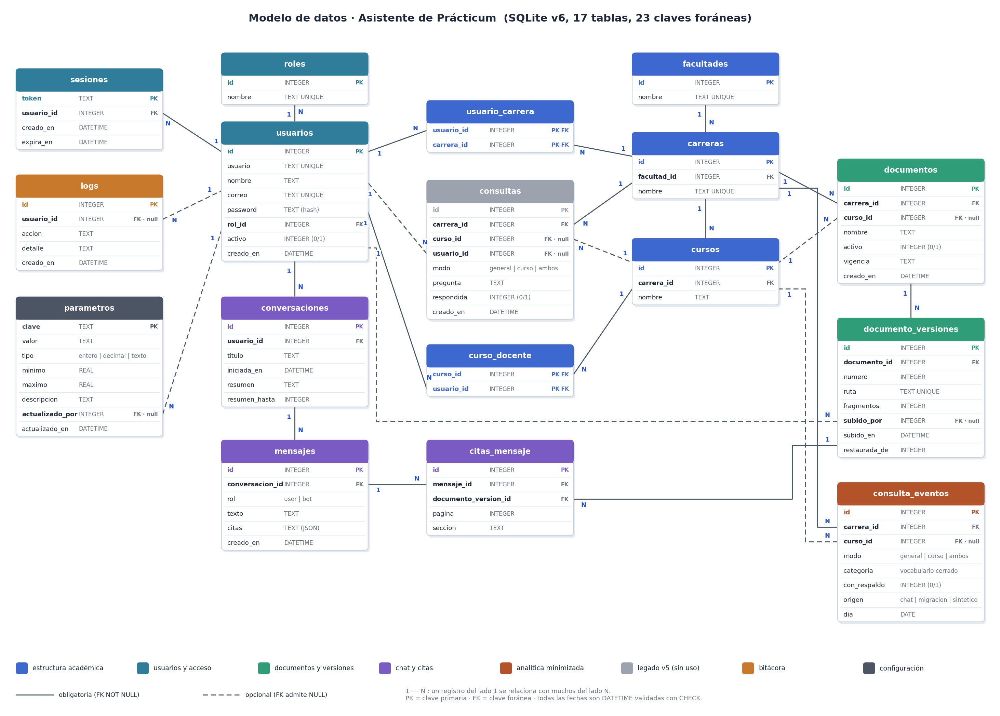
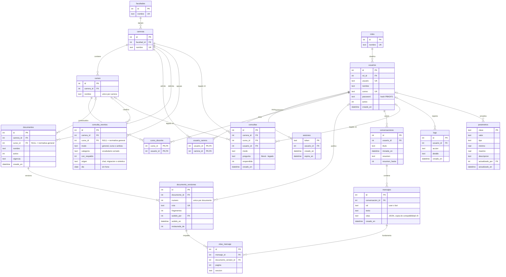

# Diseño de base de datos (esquema v6)

El sistema usa **dos almacenes** y los PDF en disco:

| Almacén | Tecnología | Ubicación | Qué guarda |
|---|---|---|---|
| Relacional | SQLite | `datos/sistema.db` | Toda la información del sistema (**17 tablas**, 23 claves foráneas) |
| Vectores | ChromaDB | `datos/chroma_db/` | Fragmentos de los PDF y sus embeddings |
| Archivos | carpetas | `datos/docs/<carrera>/global/` y `datos/docs/<carrera>/cursos/<curso>/` | Los PDF; las versiones anteriores, en la subcarpeta `_versiones/` |



El diagrama se genera con `python documentacion/generar_modelo_bd.py` y dibuja
las 23 claves foráneas de `nucleo/bd.py`: línea continua si la FK es obligatoria
(NOT NULL) y discontinua si admite NULL.

**Qué cambió de la v5 a la v6** (migración aditiva, no borra nada):

| Cambio | Para qué | Requisitos |
|---|---|---|
| Tabla `citas_mensaje` | Cada cita queda enlazada por clave foránea a la **versión exacta** del documento que respaldó la respuesta | RF-06, RF-12, RF-15, RNF-09 |
| Tabla `consulta_eventos` | Analítica **minimizada**: categoría de la consulta, sin pregunta literal, sin usuario y con la fecha truncada al día | RF-17, RF-21, RNF-04 |
| 5 disparadores | Reglas que una FK sola no expresa (curso y carrera coherentes; solo docentes de la carrera se asignan a un curso) | RF-13, RF-18, RF-19 |
| `consultas` pasa a **legado** | Guardaba la pregunta literal ligada al usuario; ya no se escribe ni se lee | RNF-04 |

---

## 1. Diagrama entidad-relación



### Las relaciones, una por una

| # | Relación (hija → padre) | Cardinalidad | Al borrar el padre | Qué significa |
|---|---|---|---|---|
| 1 | `carreras.facultad_id` → `facultades` | N:1 obligatoria | RESTRICT | Una carrera pertenece a una facultad; no se borra una facultad con carreras |
| 2 | `cursos.carrera_id` → `carreras` | N:1 obligatoria | CASCADE | Un curso existe dentro de una carrera |
| 3 | `usuarios.rol_id` → `roles` | N:1 obligatoria | RESTRICT | Cada usuario tiene exactamente un rol |
| 4-5 | `usuario_carrera` → `usuarios`, `carreras` | N:M | CASCADE | A qué carreras pertenece cada usuario (define su ámbito de acceso) |
| 6-7 | `curso_docente` → `cursos`, `usuarios` | N:M | CASCADE | Qué docentes dictan cada curso (define qué gestiona cada docente) |
| 8 | `sesiones.usuario_id` → `usuarios` | N:1 obligatoria | CASCADE | Sesiones abiertas de un usuario; se revocan al desactivarlo |
| 9 | `documentos.carrera_id` → `carreras` | N:1 obligatoria | CASCADE | Todo documento es de una carrera |
| 10 | `documentos.curso_id` → `cursos` | N:1 opcional | CASCADE | Si tiene curso, es material de ese curso; si es NULL, es normativa general |
| 11 | `documento_versiones.documento_id` → `documentos` | N:1 obligatoria | CASCADE | Cada subida del PDF es una versión; un documento tiene al menos una |
| 12 | `documento_versiones.subido_por` → `usuarios` | N:1 opcional | SET NULL | Quién publicó la versión (se conserva la versión aunque se borre el usuario) |
| 13 | `conversaciones.usuario_id` → `usuarios` | N:1 obligatoria | CASCADE | El historial es de su dueño |
| 14 | `mensajes.conversacion_id` → `conversaciones` | N:1 obligatoria | CASCADE | Mensajes de una conversación |
| 15 | `citas_mensaje.mensaje_id` → `mensajes` | N:1 obligatoria | CASCADE | Citas de una respuesta; se van con ella |
| 16 | `citas_mensaje.documento_version_id` → `documento_versiones` | N:1 obligatoria | **RESTRICT** | La versión citada no se puede borrar mientras una respuesta la cite |
| 17 | `consulta_eventos.carrera_id` → `carreras` | N:1 obligatoria | RESTRICT | Ámbito del evento analítico |
| 18 | `consulta_eventos.curso_id` → `cursos` | N:1 opcional | SET NULL | Curso desde el que se consultó, si lo hubo |
| 19-21 | `consultas` → `carreras`, `cursos`, `usuarios` | legado v5 | CASCADE / SET NULL | Sin uso desde la v6 |
| 22 | `logs.usuario_id` → `usuarios` | N:1 opcional | SET NULL | Bitácora: quién hizo qué |
| 23 | `parametros.actualizado_por` → `usuarios` | N:1 opcional | SET NULL | Quién cambió un parámetro |

`consulta_eventos` **no tiene relación con `usuarios`, `conversaciones` ni
`mensajes`**: es deliberado, para que la analítica no pueda vincularse a una
persona.

---

## 2. Diccionario de datos

Definido en `nucleo/bd.py`, que es la **fuente de verdad** del esquema.

### Estructura académica

| Tabla | Columnas | Reglas |
|---|---|---|
| `facultades` | id, nombre | nombre único y no vacío |
| `carreras` | id, facultad_id, nombre | nombre único y no vacío |
| `cursos` | id, carrera_id, nombre | único por (carrera, nombre) |
| `curso_docente` | curso_id, usuario_id | PK compuesta. **Disparador:** solo acepta un usuario con rol docente que pertenezca a la carrera del curso |

### Usuarios y acceso

| Tabla | Columnas | Reglas |
|---|---|---|
| `roles` | id, nombre | estudiante, docente, coordinacion, administrador |
| `usuarios` | id, usuario, nombre, correo, password, rol_id, activo, creado_en | usuario y correo únicos; correo con formato validado; password = hash PBKDF2-HMAC-SHA256 con sal (nunca en claro) |
| `usuario_carrera` | usuario_id, carrera_id | PK compuesta |
| `sesiones` | token, usuario_id, creado_en, expira_en | el token viaja solo en el encabezado `Authorization`; caduca según el parámetro `horas_sesion` |

Un usuario **desactivado** (`activo = 0`) no puede iniciar sesión y sus
sesiones abiertas se cierran. Si a un docente se le retira una carrera o deja
de ser docente, pierde los cursos asignados de esa carrera (`nucleo/auth.py`).

**Qué puede hacer cada rol** (la API lo valida en cada ruta; la interfaz solo
oculta lo que cada rol no usa):

| Rol | Puede | No puede |
|---|---|---|
| estudiante | Chat sobre las carreras a las que pertenece, su propio historial, abrir las páginas citadas de documentos de su carrera | Ver documentos, métricas o usuarios; leer conversaciones ajenas; consultar otra carrera |
| docente | Documentos y análisis de consultas de **sus cursos asignados** | Tocar cursos ajenos o la normativa general; asignar docentes; usar el chat |
| coordinacion | En **sus carreras**: normativa general, cursos, asignación de docentes, estudiantes y docentes, panel de análisis | Salir de sus carreras; crear coordinadores o administradores; alterar lo que un usuario compartido tiene en otra carrera |
| administrador | Facultades y carreras, todos los usuarios, parámetros, bitácora | Ver documentos ni análisis de consultas (no pertenece a carreras) |

### Documentos del RAG

| Tabla | Columnas | Reglas |
|---|---|---|
| `documentos` | id, carrera_id, curso_id, nombre, activo, vigencia, creado_en | único por (carrera, curso o general, nombre). **Disparador:** si tiene curso, el curso debe ser de esa misma carrera |
| `documento_versiones` | id, documento_id, numero, ruta, fragmentos, subido_por, subido_en, restaurada_de | número ≥ 1 y único por documento; ruta única |

- Subir un PDF con un nombre que ya existe en ese ámbito crea la **versión
  siguiente**. La anterior se mueve a `_versiones/` y su `ruta` se actualiza.
- **Restaurar** funciona como `git revert`: restaurar la v1 cuando la vigente
  es la v3 crea una **v4** con el contenido de la v1 (`restaurada_de = 1`).
- Solo la versión vigente (la de número más alto) está indexada en ChromaDB.
- **Desactivar** un documento quita sus fragmentos de ChromaDB (el chat deja
  de usarlo) sin borrar nada. **Activarlo** lo vuelve a indexar.
- **Eliminar** un documento se rechaza (HTTP 409) si alguna respuesta del chat
  lo cita: en ese caso se desactiva. Así una cita histórica nunca queda rota.

### Chat y citas

| Tabla | Columnas | Reglas |
|---|---|---|
| `conversaciones` | id, usuario_id, titulo, iniciada_en, resumen, resumen_hasta | solo su dueño la lee, la usa o la borra |
| `mensajes` | id, conversacion_id, rol, texto, citas, creado_en | rol ∈ {user, bot}; `citas` es un JSON que se conserva como copia de compatibilidad con la v5 |
| `citas_mensaje` | id, mensaje_id, documento_version_id, pagina, seccion | página ≥ 1; única por (mensaje, versión, página, sección) |

**Cómo se abre una cita.** La respuesta del chat trae, por cada cita,
`documento_id`, `version` y `pagina` (nunca una ruta de archivo). El visor pide
`GET /documentos/{id}/versiones/{numero}/paginas/{pagina}` y el servidor busca
en el catálogo el archivo **de esa versión**. Por eso, si después se publica la
v2, una respuesta antigua sigue mostrando la página de la v1 que la respaldó.

La **memoria conversacional** (`nucleo/memoria.py`) usa `conversaciones.resumen`
y `resumen_hasta`; solo sirve para entender la pregunta: la respuesta sale
únicamente de los documentos.

### Analítica y auditoría

| Tabla | Columnas | Reglas |
|---|---|---|
| `consulta_eventos` | id, carrera_id, curso_id, modo, categoria, con_respaldo, origen, dia | categoría ∈ vocabulario cerrado; modo ∈ {general, curso, ambos}; origen ∈ {chat, migracion, sintetico}; `dia` es una fecha sin hora. **Disparador:** el curso debe ser de la carrera |
| `consultas` | id, carrera_id, curso_id, usuario_id, modo, pregunta, respondida, creado_en | **Legado v5.** No se escribe ni se lee |
| `logs` | id, usuario_id, accion, detalle, creado_en | bitácora: login, login fallido, altas, bajas, cambios de documentos y de parámetros |

**Categorías** (`nucleo/categorias.py`): `horas`, `plazos`, `formatos`,
`evaluacion`, `requisitos`, `tramites`, `otros`. La pregunta se clasifica en
memoria por palabras clave (determinístico, sin llamar al modelo) y se descarta;
solo se guarda la categoría. Es una heurística sencilla cuya precisión **no está
evaluada**; el vocabulario debe validarse con la coordinación.

El panel (`GET /metricas`) devuelve únicamente agregados: totales, categorías
más consultadas, **brechas documentales** (categorías con consultas sin
respaldo) y, para la coordinación, el reparto por ámbito (normativa general y
cada curso). Los saludos y agradecimientos no se cuentan como consultas.

### Configuración del sistema

| Tabla | Columnas | Nota |
|---|---|---|
| `parametros` | clave, valor, tipo, minimo, maximo, descripcion, actualizado_por, actualizado_en | valores que antes estaban fijos en el código |

El administrador los cambia desde **Configuración** (umbral de similitud, top-k,
máximo de citas, modelo, temperatura, horas de sesión, tamaño máximo de PDF y
los mensajes fijos del asistente). Cada valor se valida por tipo y rango, y
cada cambio queda en `logs`. La **API key** del modelo no es un parámetro: es un
secreto y se queda en `secretos.toml` o en variables de entorno.

---

## 3. Reglas de integridad

- **Claves foráneas** activadas en cada conexión (`PRAGMA foreign_keys = ON`)
  y con `ON DELETE` definido (ver la tabla de relaciones).
- **CHECK** en los valores cerrados: `activo IN (0,1)`, `rol IN ('user','bot')`,
  `modo`, `categoria`, `origen`, formato de correo, nombres no vacíos, página ≥ 1.
- **Fechas**: columnas `DATETIME` (o `DATE` en `consulta_eventos.dia`) que se
  llenan solas y tienen un `CHECK` que rechaza texto que no sea una fecha válida.
- **Disparadores** (lo que una FK no puede expresar):
  - `trg_documentos_curso_carrera_ins/upd` y `trg_consulta_eventos_curso_carrera_ins/upd`:
    un documento o un evento con curso debe ser de la carrera de ese curso.
  - `trg_curso_docente_ins`: solo se asigna a un curso a un docente de su carrera.
- **Transacciones**: cada operación corre dentro de `bd.transaccion()`; si algo
  falla se hace `ROLLBACK`.
- **Índices** sobre las claves foráneas más consultadas.
- **Archivos, SQLite y ChromaDB** no comparten transacción: la ingesta deshace
  sus pasos si algo falla y `ingest.reconciliar()` corrige diferencias al arrancar.

Todas estas reglas tienen prueba automática en `pruebas/test_v1_seguridad.py`
(clase `PruebasIntegridad`).

---

## 4. Privacidad y retención de datos

| Dato | Dónde vive | Quién lo ve | Retención |
|---|---|---|---|
| Preguntas y respuestas | `mensajes` (historial del estudiante) | Solo su dueño | Hasta que el estudiante borra la conversación o se elimina su cuenta (CASCADE) |
| Analítica | `consulta_eventos` | Coordinación (su carrera) y docente (su curso), solo como agregados | Indefinida: no contiene pregunta, usuario ni hora |
| Bitácora | `logs` | Administrador | Pendiente de definir con la institución |
| Consultas literales v5 | `consultas` (legado) | Nadie (ninguna ruta la lee) | **Pendiente de decisión.** No se borra automáticamente |

- Borrar una conversación elimina sus mensajes y sus citas; los agregados no
  cambian porque no están vinculados a ella.
- Riesgo residual documentado: en un ámbito con muy pocos estudiantes, un
  agregado pequeño (por ejemplo "1 consulta de plazos hoy en el curso X") podría
  atribuirse a alguien. Mitigación pendiente de validar: umbral mínimo de
  frecuencia antes de mostrar una categoría.
- Depuración manual de la tabla legado, **solo cuando la institución apruebe la
  política** (previo respaldo; sus datos ya están representados, sin texto ni
  usuario, en `consulta_eventos` con origen `migracion`):

  ```sql
  -- opción A: conservar el texto pero desvincularlo de la persona
  UPDATE consultas SET usuario_id = NULL;
  -- opción B: eliminar las preguntas literales
  DELETE FROM consultas;
  ```

---

## 5. Versiones del esquema y migraciones

La versión se guarda en `PRAGMA user_version` (= 6). Al arrancar,
`bd.inicializar()` lleva una base antigua a la versión actual:

| De → a | Qué hace |
|---|---|
| v1 | Se recrea (era otro modelo, solo datos de demostración) |
| v2 → v3 | Columna `restaurada_de`; a cada docente se le asignan los cursos de su carrera para que no pierda acceso |
| v3 → v4 | Columnas del resumen de la memoria conversacional |
| v4 → v5 | Columna `vigencia` de los documentos |
| **v5 → v6** | Tablas `citas_mensaje` y `consulta_eventos`, disparadores e índices. Copia las citas del JSON a `citas_mensaje` y deriva un evento (sin texto ni usuario, origen `migracion`) por cada fila de `consultas` |

Garantías de la migración v6, comprobadas en la prueba
`PruebasMigracionV6` y en el ensayo sobre una copia de la base real:

1. **Respaldo automático** previo en `datos/respaldos/sistema_v5_<fecha>.db`
   (API de backup de SQLite).
2. **Aditiva:** las 15 tablas anteriores quedan idénticas fila por fila.
3. **Íntegra:** `PRAGMA integrity_check = ok` y `PRAGMA foreign_key_check` vacío.
4. **Repetible:** volver a arrancar no duplica filas ni crea otro respaldo.

Para volver atrás basta restaurar el respaldo sobre `datos/sistema.db` con el
código anterior.

---

## 6. Base vectorial (ChromaDB)

No es relacional. Cada fragmento se guarda con su texto (título de la sección +
trozo de ~500 caracteres), su embedding (384 números, MiniLM) y estos metadatos:

```json
{
  "fuente": "Modelo_de_Practicas_Preprofesionales_RR_2023.pdf",
  "pagina": 25,
  "seccion": "14 Evidencias de las prácticas preprofesionales › 14.2 Prácticas de inserción…",
  "scope": "computacion|global",
  "path": "computacion/global/Modelo_de_Practicas_Preprofesionales_RR_2023.pdf",
  "documento_id": 1,
  "version": 1,
  "contexto": "texto completo de la sección (hasta 1.800 caracteres)"
}
```

- `scope` = `<carrera>|global` o `<carrera>|curso:<curso>`; la búsqueda filtra
  por él según el ámbito elegido en el chat.
- id = `d<documento_id>v<version>-<n>`.
- `contexto` es lo que lee el modelo de lenguaje; el texto corto es lo que se
  convierte en vector (ver DISENO_ARQUITECTURA.md, "Fragmentación por secciones").

El vínculo entre las dos bases es el **id de documento y su versión**:
ChromaDB solo contiene fragmentos de la versión vigente de documentos activos.
`ingest.reconciliar()` lo comprueba y corrige al arrancar.

---

## 7. Si cambias de computadora

`sistema.db` y `chroma_db/` no viajan en git. `python arrancar.py` crea la base,
registra los PDF de `datos/docs/` con la vigencia de `datos/docs/vigencias.json`
y reconcilia ChromaDB. Si copias una `sistema.db` de una versión anterior, se
actualiza sola al arrancar (con respaldo previo).

La variable de entorno `PRACTICUM_DATOS` cambia la carpeta de datos: la usan las
pruebas automáticas para trabajar sobre una copia temporal sin tocar `datos/`.
