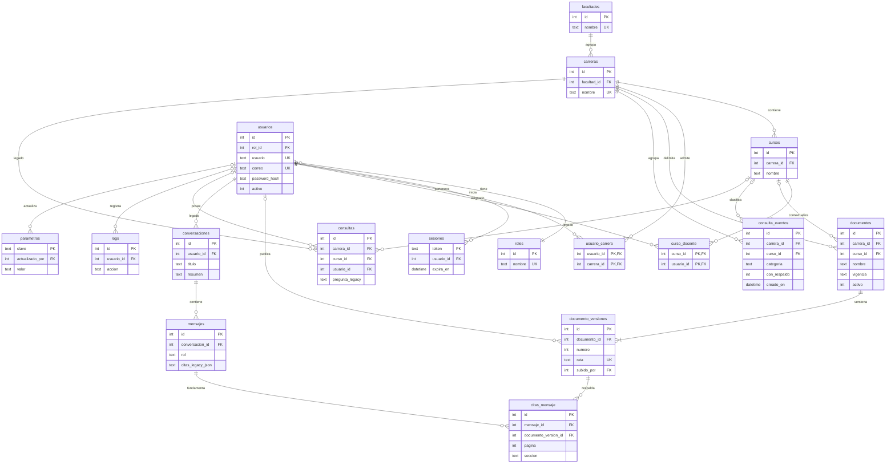

# Modelo de datos lógico V1 (propuesta de revisión)

**Fecha:** 10/11/2026 · **Estado:** diseño de destino, NO migrado, NO aprobado por la institución.

## 1. Criterio de diseño

El prototipo ya utiliza un SQLite normalizado de **15 tablas** (`nucleo/bd.py`, esquema `user_version=5`), los PDFs en disco y ChromaDB como almacenamiento vectorial. **No se recomienda reconstruir la base**: preservar 15 tablas y 19 relaciones FK existentes y agregar SOLO lo que requiere la línea base de calidad.

Los dos ajustes lógicos propuestos son:
- `citas_mensaje`: relaciona una cita y una página **con la versión documental exacta**; evita depender únicamente del JSON en `mensajes.citas`.
- `consulta_eventos`: almacena **categorías predefinidas sin texto literal, usuario ni IP** para el panel analítico. La tabla actual `consultas` queda **legacy** hasta que exista política de retención y migración probada.

**Tamaño del modelo objetivo: 17 tablas** (15 existentes + 2 propuestas), con dos almacenes externos sin FK SQL: ChromaDB (`documento_id`, `version`, `scope`) y PDF en directorios. No se almacenan embeddings ni PDFs binarios en SQLite.

## 2. Diagrama ER de relaciones principales

> **Leyenda:** el diagrama muestra asociaciones esenciales, no todas las columnas de SQLite. Los campos `curso_id` y `usuario_id` opcionales se reflejan como relaciones opcionales. `mensajes.citas` y `consultas` se conservan temporalmente por compatibilidad; no se consideran destino de privacidad.

## 3. Diccionario de datos por módulo

| Módulo | Tablas | Uso | Trazabilidad |
|---|---|---|---|
| Estructura académica | `facultades`, `carreras`, `cursos`, `curso_docente` | Carrera → curso → docentes asignados | RF-13/18/19 |
| Acceso | `roles`, `usuarios`, `usuario_carrera`, `sesiones` | Identidad, autorización y sesión revocable | RF-01/02/22; RNF-03 |
| Corpus | `documentos`, `documento_versiones` | PDF activo, historia, vigencia y publicación | RF-14/15/16/20/26 |
| Chat | `conversaciones`, `mensajes` | Preguntas por usuario, historial y respuesta | RF-03/04/09/11 |
| **Cita nueva** | **`citas_mensaje`** | Mensaje → versión exacta → página/sección | RF-06/12; RNF-09 |
| Analítica legacy | `consultas` | Conserva preguntas literales vinculadas a usuario; **riesgo pendiente** | RNF-04 |
| **Analítica objetivo** | **`consulta_eventos`** | Conteos por categorías controladas sin preguntas/usuarios literales | RF-17/21; RNF-04 |
| Auditoría | `logs`, `parametros` | Bitácora y configuración; requieren controles de retención | RNF-03/04 |

## 4. Reglas de integridad críticas

1. **Claves foráneas** siempre habilitadas en cada conexión (`PRAGMA foreign_keys=ON`).
2. **Rol + carrera + curso se validan en el backend**, no solo ocultando botones React. El esquema actual no cuenta con matrícula estudiante↔curso: el criterio de seguridad V1 solo puede exigir carrera asignada, salvo que se apruebe y cree una relación académica adicional.
3. **Ámbito documental:** si `documentos.curso_id` no es NULL, el curso debe pertenecer a `documentos.carrera_id`. La aplicación actual se apoya en lógica de negocio; agregar validación en API y, si procede, trigger.
4. **Integridad histórica:** una cita debe referenciar `documento_versiones.id`, no solo el nombre del PDF. Si existen citas a una versión, no eliminar el PDF histórico sin política y resolución del vínculo.
5. **Datos personales:** la vista de métricas no puede incluir identificadores ni preguntas crudas sin revisión de privacidad. Los registros actuales sí almacenan pregunta literal y usuario; ocultar el ID en React **no equivale** a anonimizar.
6. **Agregados:** `consulta_eventos.categoria` usa vocabulario cerrado, nunca texto generado libremente por usuarios. Restringir el acceso a eventos individuales y mostrar sumas; evaluar umbral mínimo de frecuencia para grupos pequeños.
7. **Versiones:** nueva ingesta no debe dejar la base y el índice vectorial inconsistentes; conservar operaciones con compensación y `reconciliar()`.
8. **Privacidad:** definir política documentada de consentimiento, retención, borrado y acceso antes del piloto con estudiantes reales.

## 5. Migración de v5 a destino V1, por fases

**Fase A, previa a cualquier modificación:** respaldo consistente de `datos/sistema.db`, `datos/chroma_db/` y `datos/docs/`; verificar restauración en clon aislado; inventariar filas y versiones.

**Fase B, aditiva (todavía NO aplicada):** ejecutar el borrador `documentacion/sql/V1_EXTENSION_ESQUEMA_PROPUESTA.sql` sobre una copia. Verificar `PRAGMA foreign_key_check`, índices, restricciones y conservación de filas v5. Añadir transacciones y versión de esquema en `nucleo/bd.py` para **migración v6 probada**; el SQL entregado NO cambia `user_version` porque el inicializador actual lo fija en 5.

**Fase C, doble escritura / lectores:** cuando se publica respuesta, guardar sus citas también en `citas_mensaje`; cuando se registra consulta, escribir `consulta_eventos` usando una categorización controlada. Ajustar el panel para leer solo agregados sin texto literal; evitar visualización de `consultas`.

**Fase D, política y depuración:** revisar `consultas` legacy conforme a retención y solicitud institucional. **No borrar filas ni introducir migración destructiva automáticamente**. Documentar límites de archivo histórico y conducta del borrado.

**Fase E, evidencia:** ejecutar pruebas con dos usuarios y carreras, PDF actualizado y página histórica, preguntas sensibles, borrado de historial y métricas sin fuga.

## 6. Separación entre lo existente y lo propuesto

| Componente | Estado en código inspeccionado (rama main al 10/11) | Estado destino |
|---|---|---|
| 15 tablas y 19 FK | Existe; diseño v5 | **Conservar** |
| Documento/versiones/ChromaDB | Existe | Probar consistencia y acceso |
| Mensajes con citas JSON | Existe | Añadir `citas_mensaje` normalizado |
| `consultas` con pregunta + usuario | Existe (riesgo RNF-04) | Sustituir su uso analítico por `consulta_eventos` |
| Modelo de estudiantes inscritos a curso | **No existe** | No inventar; decidir con actor institucional |
| Nuevo esquema implementado | **No** | Propuesta de migración para Claude |

**No confundir «diagrama actualizado» con «migración ejecutada».** Para la exposición, mostrar este esquema y justificar los dos cambios por RF-12/21 y RNF-04/09.
