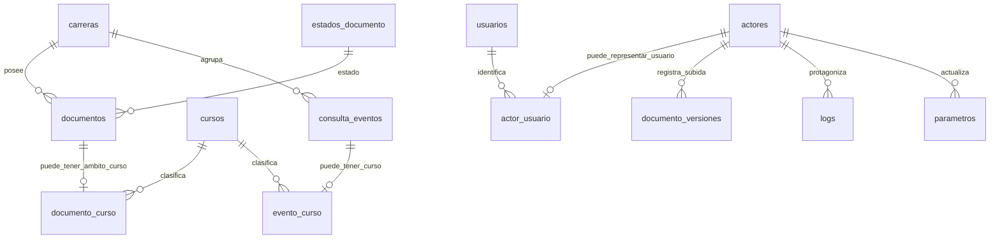

# Propuesta de rediseño del esquema v7: claves PK/FK no nulas

**Estado:** propuesta de diseño para discusión académica. **No implementada ni migrada.** La versión funcional actual sigue siendo SQLite v6 (17 tablas, 23 FK). Esta propuesta no cambia la base ni el código de producción.

## 1. Regla de modelado

- Toda **PK** y toda **FK declarada en el esquema de destino** debe ser obligatoria (`NOT NULL`). En SQLite, una `TEXT PRIMARY KEY` ordinaria no implica necesariamente `NOT NULL`: declararlo expresamente o utilizar `STRICT` / `WITHOUT ROWID` según corresponda.
- Una relación **opcional** sigue siendo opcional a nivel conceptual. No se rellena con IDs artificiales: se representa mediante la **existencia o ausencia de una fila en una tabla de asociación** cuyas FKs sí son obligatorias.
- Las columnas **no clave** (p. ej., `vigencia`, `resumen`, `restaurada_de`, `minimo`, `maximo`) pueden seguir siendo nulas si el significado de negocio lo requiere. La prohibición se aplica a PK/FK, no a cualquier atributo.
- Una **tabla de estados** representa estados de negocio (activo, archivado, etc.). No puede representar por sí sola que un documento es general o de curso ni que una operación fue automática.

## 2. Diagnóstico verificado en `nucleo/bd.py` (rama de estabilización, esquema v6)

**Siete FK opcionales**:

| Tabla | FK nullable v6 | Por qué admite NULL | Diseño candidato v7 |
|---|---|---|---|
| `documentos` | `curso_id` | Documento general de carrera, sin curso | `documento_curso(documento_id, curso_id)` (solo si aplica) |
| `consulta_eventos` | `curso_id` | Consulta a normativa general | `evento_curso(evento_id, curso_id)` (solo si aplica) |
| `documento_versiones` | `subido_por` | Carga automática o autor desconocido | `actor_id` obligatorio, con actor de sistema o procedencia histórica |
| `logs` | `usuario_id` | Evento sin usuario identificado | `actor_id` obligatorio |
| `parametros` | `actualizado_por` | Parámetro inicial por defecto | `actualizado_por_actor_id` obligatorio |
| `consultas` (legado v5) | `curso_id` | Pregunta general | Tratar con política de archivo; **no seguir utilizándola** |
| `consultas` (legado v5) | `usuario_id` | Usuario eliminado / dato histórico | Tratar con política de archivo; **no inventar autor** |

**PK de texto a explicitar**: `sesiones.token TEXT PRIMARY KEY NOT NULL`, `parametros.clave TEXT PRIMARY KEY NOT NULL`. Las PK `INTEGER PRIMARY KEY` y las PK compuestas `curso_docente` / `usuario_carrera` ya tienen tratamiento adecuado; sus componentes están explícitamente `NOT NULL`.

## 3. Modelo lógico de destino

### 3.1 Documento general frente a documento de curso

`documentos(id PK, carrera_id FK NOT NULL, nombre, ambito CHECK IN('general','curso'), estado_id FK NOT NULL, ...)` ya no tiene `curso_id`.

`documento_curso(documento_id PK/FK NOT NULL, curso_id FK NOT NULL)` solo existe cuando el documento tiene ámbito `curso`. Así no hay FK nula ni ID especial para "general". El sistema deberá verificar **exactamente**:

- `ambito='curso'` implica una asociación `documento_curso`.
- `ambito='general'` implica ninguna asociación `documento_curso`.
- El curso vinculado pertenece a la carrera del documento.

La FK solo no asegura estas invariantes intertabla. Se deben implementar **transacciones y disparadores adecuados**, más pruebas negativas; no afirmar que `CHECK` puede comprobar otra tabla.

### 3.2 Analítica general frente a analítica por curso

`consulta_eventos(id PK, carrera_id FK NOT NULL, modo, categoria, respaldo, origen, dia)` pierde `curso_id`.

`evento_curso(evento_id PK/FK NOT NULL, curso_id FK NOT NULL)` existe únicamente si el evento proviene de curso. Validar coherencia con carrera y modo `general`/`curso`/`ambos`. En consultas híbridas confirmar si se requiere uno o varios cursos antes de definir `UNIQUE(evento_id)`. No crear asociación con usuario: la privacidad de la analítica se preserva.

### 3.3 Origen humano, sistema o histórico

`actores(id PK, tipo NOT NULL)` representa un actor real del proceso: `usuario`, `sistema` o `procedencia_historica_no_identificada`.

`actor_usuario(actor_id PK/FK NOT NULL, usuario_id FK NOT NULL UNIQUE)` vincula solo actores humanos. `documento_versiones.actor_id`, `logs.actor_id` y `parametros.actualizado_por_actor_id` son FK `NOT NULL` a `actores`.

La carga automática hace referencia a un actor de sistema **real y documentado**. Las filas históricas que carecían de autor deben apuntar a procedencia histórica **explícita** (no atribuir la acción falsamente a un usuario). Requerir integridad de tipo de actor y relación humana en capa de dominio + triggers o subtipos. No borrar la cuenta física si hay auditoría que depende de ella: desactivar, retener o anonimizar según política.

### 3.4 Estados

`estados_documento(id PK NOT NULL, codigo UNIQUE NOT NULL, descripcion NOT NULL)` puede incluir `activo`, `inactivo`, `archivado` si el proceso institucional valida estos estados. `documentos.estado_id FK NOT NULL` lo referencia. Esto sustituye el `activo` booleano **solo si aporta un ciclo de vida real**, no como truco para evitar NULL en otras FKs.

### 3.5 Datos heredados

La tabla `consultas` de v5 guarda preguntas personales y 2 FKs nulas; no se puede declarar "esquema sin FK opcionales" mientras siga dentro de la base v7. **No borrarla inmediatamente**: definir retención con la institución, respaldar y, si corresponde, mover a un archivo SQLite histórico restringido o depurar legalmente antes de retirar la tabla del esquema principal. Nunca inventar relaciones de usuario o curso para completar datos antiguos.

## 4. Cambios transversales obligatorios

- **No** usar `usuario_id = 0`, `curso_id = 0` ni un curso «General» ficticio; eso confunde identidad con ausencia de relación.
- Las FK nuevas son `NOT NULL`. Sustituir `ON DELETE SET NULL`: usar `RESTRICT` donde deba mantenerse integridad histórica, o eliminar la fila de asociación cuando se retire un vínculo opcional. Elegir cada acción según el caso.
- Revisar `nucleo/bd.py`, `nucleo/ingest.py`, `nucleo/metricas.py`, `nucleo/historial.py`, `nucleo/auth.py`, API, tests, diagrama y capítulo 3 de tesis.
- Validar restricciones relacionales con transacciones y triggers; casos negativos de documento general, curso ajeno, evento de otro ámbito, subida del sistema y auditoría tras desactivación.
- Verificar también todas las PK, incluyendo `TEXT PRIMARY KEY` en SQLite; considerar `WITHOUT ROWID` en tablas puente con PK compuesta, con análisis de compatibilidad.

## 5. Plan de transición seguro

1. Congelar y **respaldar v6**, incluyendo `sistema.db`, PDF e índice ChromaDB; probar restauración.
2. Inventariar valores NULL reales por columna y relaciones existentes; aislar `consultas` legado, sin borrado automático.
3. Diseñar tablas de asociación y `actores` en una **base clonada**, con DDL no nulo, índices, migración reversible y `PRAGMA user_version=7` al finalizar.
4. Trasladar datos usando identificadores estables: general → ausencia de asociación; curso → fila en asociación; autor ausente → actor histórico documentado. Probar restricciones referenciales y de coherencia.
5. Adaptar consumidores, consultas y API en una misma rama. Pruebas completas de permisos, citas versionadas, migración v5→v6→v7 y reversión controlada.
6. Comparar conteos y hashes relevantes antes/después; `PRAGMA foreign_key_check`, `PRAGMA integrity_check`; observar la demo estudiante/docente/coordinación.
7. Solo tras la validación técnica, actualizar el diagrama del repositorio, el capítulo 3 y la diapositiva de base de datos. **Hasta entonces presentar v6 como implementado y v7 como rediseño propuesto.**

## 6. Trazabilidad

- Clasificación documental: RF-14, RF-20, RNF-03, RNF-09.
- Cursos/carreras y permisos: RF-02, RF-13, RF-18, RF-19.
- Analítica de consultas: RF-17, RF-21, RNF-04.
- Citas exactas: RF-06, RF-12, RF-15.
- Estados y auditoría: RF-15, RF-16, RF-22, RNF-03, RNF-04.

**Aclaración:** este rediseño cumple una decisión de calidad de datos, no un requisito de que todas las relaciones conceptuales sean obligatorias. Los vínculos opcionales se modelan sin claves foráneas nulas, mediante asociaciones 0..1 en tablas separadas. Validar la decisión con la ingeniera antes de modificar el esquema v6 funcional.
